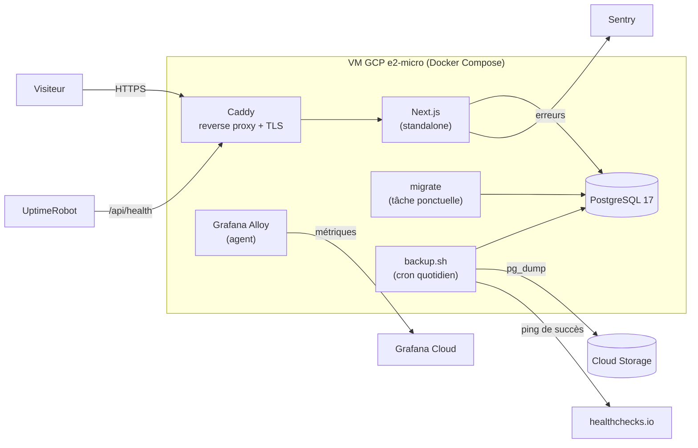
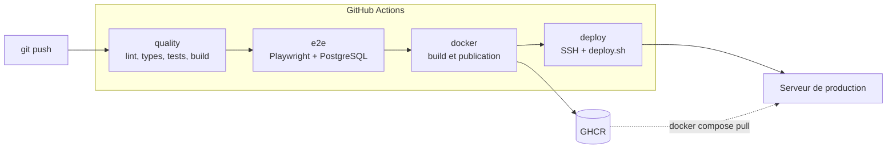

# 🛒 E-commerce Next.js

[](https://github.com/LarryJason/e-commerce/actions/workflows/ci.yml)

Application e-commerce fullstack développée avec Next.js et PostgreSQL, accompagnée d'une chaîne DevOps complète : tests automatisés, conteneurisation, intégration et déploiement continus, monitoring et sauvegardes.

**Démo en ligne : [larry-shop.duckdns.org](https://larry-shop.duckdns.org)**

<!-- À compléter : ajouter une capture d'écran de la boutique -->
<!--  -->

---

## Sommaire

- [Fonctionnalités](#fonctionnalités)
- [Stack technique](#stack-technique)
- [Architecture](#architecture)
- [Démarrage en local](#démarrage-en-local)
- [Tests](#tests)
- [Pipeline CI/CD](#pipeline-cicd)
- [Déploiement](#déploiement)
- [Monitoring et exploitation](#monitoring-et-exploitation)
- [Sécurité](#sécurité)
- [Structure du projet](#structure-du-projet)
- [Choix techniques et problèmes résolus](#choix-techniques-et-problèmes-résolus)
- [Pistes d'amélioration](#pistes-damélioration)

---

## Fonctionnalités

- Catalogue de produits
- Inscription et connexion, avec sessions signées
- Panier persistant, stocké en base de données
- Passage de commande et annulation
- Redirection vers la page protégée demandée après connexion

<!-- À compléter : ajouter les autres fonctionnalités (administration, recherche, etc.) -->

---

## Stack technique

| Domaine | Outils |
|---|---|
| Application | Next.js 16 (App Router), React 19, TypeScript |
| Interface | Tailwind CSS 4, daisyUI |
| Données | PostgreSQL 17, `pg` (sans ORM), Zod pour la validation |
| Tests | Vitest, React Testing Library, Playwright |
| Conteneurisation | Docker (build multi-stage), Docker Compose |
| CI/CD | GitHub Actions, GitHub Container Registry (GHCR), Dependabot |
| Hébergement | Google Cloud Compute Engine (e2-micro, offre Always Free) |
| Reverse proxy | Caddy (HTTPS automatique via Let's Encrypt), DuckDNS |
| Monitoring | UptimeRobot, Sentry, Grafana Cloud + Grafana Alloy, healthchecks.io |
| Sauvegardes | `pg_dump` + Google Cloud Storage |

---

## Architecture

### Production



Seul Caddy est exposé sur Internet (ports 80 et 443). L'application et la base de données ne sont joignables que depuis le réseau interne Docker.

### Pipeline CI/CD



Les jobs `docker` et `deploy` ne s'exécutent que pour un push sur `main`. Sur une pull request, seules les vérifications tournent.

---

## Démarrage en local

### Prérequis

- Node.js 20.12 ou supérieur (Node 22 recommandé)
- Docker et Docker Compose

### Installation

```bash
git clone https://github.com/LarryJason/e-commerce.git
cd e-commerce
npm ci
cp .env.example .env.local    # puis compléter les valeurs
```

### Lancer l'application en mode développement

La base de données tourne dans Docker, l'application directement sur la machine :

```bash
npm run db:up       # démarre PostgreSQL
npm run db:setup    # applique les migrations et insère les données de démo
npm run dev         # http://localhost:3000
```

### Lancer toute la stack dans Docker

Pour reproduire un environnement proche de la production (build de production, migrations dans un conteneur dédié) :

```bash
cp .env.docker.example .env.docker
docker compose up -d --build
docker compose run --rm migrate npm run db:seed
```

L'application est disponible sur http://localhost:3000.

### Variables d'environnement

Toutes les variables nécessaires sont listées dans [`.env.example`](.env.example).

| Variable | Rôle |
|---|---|
| `DATABASE_URL` | Chaîne de connexion PostgreSQL |
| `SESSION_SECRET` | Secret de signature des cookies de session (32 caractères minimum) |

<!-- À compléter si d'autres variables existent -->

### Scripts disponibles

| Commande | Rôle |
|---|---|
| `npm run dev` | Serveur de développement |
| `npm run build` / `npm run start` | Build et serveur de production |
| `npm run lint` | ESLint |
| `npm run typecheck` | Vérification des types TypeScript |
| `npm run test` | Tests unitaires et de composants (Vitest) |
| `npm run test:watch` | Vitest en mode surveillance |
| `npm run test:coverage` | Tests avec rapport de couverture |
| `npm run test:e2e` | Tests end-to-end (Playwright) |
| `npm run check` | Lint + types + tests + build, en une commande |
| `npm run db:up` / `npm run db:down` | Démarrer / arrêter la base locale |
| `npm run db:migrate` / `npm run db:seed` | Migrations / données de démo |

---

## Tests

La stratégie suit la pyramide des tests :

- **Tests unitaires** (Vitest) : logique métier pure, comme le calcul du panier. Les fichiers `*.test.ts` sont placés à côté du code testé.
- **Tests de composants** (React Testing Library) : comportement des composants client.
- **Tests de routes** : par exemple l'endpoint `/api/health`, avec la base de données simulée.
- **Tests end-to-end** (Playwright, dossier `e2e/`) : parcours critiques dans un vrai navigateur (connexion, ajout au panier, commande puis annulation), sur Chromium, Firefox et WebKit, contre un build de production.

```bash
npm run check       # tout sauf les E2E
npm run test:e2e    # nécessite une base de données accessible
```

---

## Pipeline CI/CD

Le workflow [`.github/workflows/ci.yml`](.github/workflows/ci.yml) enchaîne quatre jobs :

| Job | Déclenchement | Rôle |
|---|---|---|
| `quality` | push et pull request | Lint, typecheck, tests unitaires avec couverture, build, validation du Compose de production |
| `e2e` | après `quality` | Tests Playwright contre une base PostgreSQL de service |
| `docker` | push sur `main` | Construit et publie deux images sur GHCR : `e-commerce` (application) et `e-commerce-migrate` (migrations) |
| `deploy` | après `docker` | Copie la configuration sur le serveur, déploie la nouvelle version, vérifie `/api/health` |

Chaque image est taguée `latest` et `sha-<commit>`. La production déploie toujours le tag SHA, ce qui permet de savoir exactement quelle version tourne et de revenir en arrière facilement.

Dependabot ([`.github/dependabot.yml`](.github/dependabot.yml)) propose chaque semaine les mises à jour des dépendances npm, des actions GitHub et des images Docker de base.

---

## Déploiement

### Infrastructure

- **Serveur** : VM Google Cloud e2-micro (us-east1, disque standard de 30 Go, swap de 2 Go), dans les limites de l'offre Always Free.
- **Domaine** : sous-domaine DuckDNS, mis à jour automatiquement par une tâche cron.
- **HTTPS** : certificats Let's Encrypt obtenus et renouvelés automatiquement par Caddy.

### Configuration de production

Le dossier [`deploy/`](deploy/) contient tout ce qui est copié sur le serveur (dans `~/ecommerce/`) par la pipeline :

| Fichier | Rôle |
|---|---|
| `compose.yaml` | Stack de production : `db`, `migrate`, `app`, `caddy`, `alloy` |
| `Caddyfile` | Configuration du reverse proxy |
| `config.alloy` | Collecte et envoi des métriques système |
| `deploy.sh` | Déploiement d'une version donnée |
| `backup.sh` | Sauvegarde de la base de données |

### Secrets

Aucun secret n'est versionné.

**Secrets GitHub Actions :**

| Secret | Rôle |
|---|---|
| `SSH_HOST`, `SSH_USER` | Cible du déploiement |
| `SSH_PRIVATE_KEY` | Clé SSH dédiée au déploiement |
| `SSH_KNOWN_HOSTS` | Empreinte du serveur (protection contre l'usurpation) |
| `SENTRY_AUTH_TOKEN` | Envoi des source maps à Sentry, transmis au build Docker via un secret de build |

**Fichiers présents uniquement sur le serveur :**

| Fichier | Contenu |
|---|---|
| `.env.prod` | Identifiants PostgreSQL, `DATABASE_URL`, `SESSION_SECRET`, `SENTRY_ENABLED` |
| `.env.monitoring` | Identifiants d'envoi vers Grafana Cloud |
| `.env` | Version déployée (`IMAGE_TAG`), écrit par `deploy.sh` |
| `~/backup-key.json` | Clé du compte de service autorisé uniquement à écrire les sauvegardes |

### Déployer

Le déploiement est automatique à chaque push sur `main`. Pour déployer manuellement une version précise depuis le serveur :

```bash
~/ecommerce/deploy.sh sha-<commit>
```

### Revenir à une version précédente (rollback)

```bash
git log --oneline -5                       # repérer le SHA de la version stable
~/ecommerce/deploy.sh sha-<sha_precedent>  # sur le serveur
```

Le rollback ne concerne que le code : les migrations de base de données ne sont pas annulées. Les migrations sont donc écrites de façon compatible avec la version précédente du code (ajout de colonnes plutôt que renommage, suppression différée).

---

## Monitoring et exploitation

| Besoin | Outil |
|---|---|
| Le site répond-il ? | UptimeRobot interroge `/api/health` toutes les 5 minutes et alerte par email |
| L'app et la base sont-elles en bonne santé ? | `/api/health` vérifie la connexion à PostgreSQL (`200` ou `503`) |
| Que s'est-il passé ? | Logs JSON structurés, avec rotation (3 × 10 Mo par conteneur) |
| Des utilisateurs rencontrent-ils des bugs ? | Sentry (navigateur et serveur), relié au SHA de chaque release |
| Le serveur manque-t-il de ressources ? | Grafana Cloud : tableau de bord et alertes RAM, swap, disque et CPU |
| Les sauvegardes fonctionnent-elles ? | healthchecks.io alerte si aucune sauvegarde n'a réussi depuis 24 h |

### Commandes utiles sur le serveur

```bash
cd ~/ecommerce
docker compose ps                          # état des services
docker compose logs -f --since 1h app      # logs de l'application
docker stats --no-stream                   # consommation par conteneur

# Uniquement les erreurs de l'application
docker compose logs --no-log-prefix app | jq -R 'fromjson? | select(.level == "error")'

# Requêtes ayant provoqué une erreur serveur
docker compose logs --no-log-prefix caddy | jq -R 'fromjson? | select(.status >= 500)'
```

### Sauvegardes

`backup.sh` s'exécute chaque nuit à 3 h (UTC) :

1. export compressé de la base avec `pg_dump -Fc` ;
2. copie dans un bucket Cloud Storage (rétention de 30 jours) ;
3. conservation locale de 7 jours ;
4. signal de succès envoyé à healthchecks.io.

Le compte de service du serveur peut uniquement **ajouter** des fichiers dans le bucket : il ne peut ni les lire ni les supprimer, ce qui protège les sauvegardes même en cas de compromission du serveur.

### Restaurer une sauvegarde

Récupérer le fichier `.dump` (sur le serveur dans `~/backups/`, ou depuis la console Cloud Storage), puis :

```bash
cd ~/ecommerce
docker compose stop app
docker compose exec -T db sh -c 'pg_restore -U "$POSTGRES_USER" -d "$POSTGRES_DB" --clean --if-exists' < fichier.dump
docker compose start app
```

La procédure est testée régulièrement en restaurant dans une base temporaire (`restore_test`), sans toucher à la production.

---

## Sécurité

- Base de données et application non exposées sur Internet : seul Caddy publie des ports.
- HTTPS obligatoire, cookie de session `Secure`.
- Connexion SSH par clé uniquement, fail2ban contre les tentatives répétées.
- Clé SSH dédiée au déploiement, révocable indépendamment.
- Secrets hors de Git, fichiers en `chmod 600`, chaque conteneur ne reçoit que les secrets dont il a besoin.
- Jetons à privilèges minimaux : lecture seule pour GHCR sur le serveur, écriture seule pour les métriques et les sauvegardes.
- Secret Sentry transmis au build Docker par un secret de build, jamais enregistré dans l'image.
- Conteneur applicatif exécuté avec un utilisateur non root.
- Aucune donnée personnelle envoyée à Sentry (`sendDefaultPii: false`), aucune donnée sensible dans les logs.

---

## Structure du projet

```
.
├── app/                    # App Router : pages, server actions, routes API (dont /api/health)
├── components/             # Composants React
├── lib/                    # Accès à la base (pg), logger, logique métier
├── scripts/                # migrate.ts, seed.ts
├── e2e/                    # Tests Playwright
├── deploy/                 # Configuration de production (copiée sur le serveur)
├── .github/
│   ├── workflows/ci.yml    # Pipeline CI/CD
│   └── dependabot.yml
├── Dockerfile              # Multi-stage : deps → migrator / builder → runner
├── compose.yaml            # Stack Docker locale
├── vitest.config.mts
├── playwright.config.ts
└── .env.example
```

<!-- À adapter selon l'arborescence réelle -->

---

## Choix techniques et problèmes résolus

Quelques décisions et difficultés rencontrées lors de la mise en place de la chaîne DevOps :

- **Image Docker multi-stage avec le mode `standalone` de Next.js** : l'image finale ne contient que le serveur et les dépendances strictement nécessaires. Une étape `migrator` séparée embarque l'outillage des migrations, absent de l'image de production.
- **Configuration explicite révélée par la CI** : les tests E2E échouaient en CI car `SESSION_SECRET`, présent uniquement dans le `.env.local` du poste de développement, manquait. La CI a forcé à rendre toute la configuration explicite.
- **Changement d'hébergeur** : la capacité ARM gratuite d'Oracle Cloud étant saturée, le déploiement a été migré vers GCP. Seule la préparation du serveur a changé : images, Compose et pipeline sont restés identiques.
- **Résilience face aux pannes de la base** : un test de panne a montré que l'application ne se reconnectait pas après le redémarrage de PostgreSQL. Le pool de connexions a été configuré avec des délais maximaux et un gestionnaire d'erreurs pour se rétablir seul.
- **Secrets de build Docker** : le jeton Sentry est monté uniquement pendant le build (`RUN --mount=type=secret`) plutôt que via `ARG`/`ENV`, qui l'auraient enregistré dans l'image.
- **Validation de la configuration en amont** : une erreur d'indentation YAML dans le Compose de production n'était détectée qu'au déploiement. Elle est désormais vérifiée dès le premier job de la CI.
- **Sobriété sur 1 Go de RAM** : swap, rotation des logs, agent de métriques plafonné à 200 Mo, stockage et tableaux de bord délégués à Grafana Cloud.

---

## Pistes d'amélioration

- Décrire l'infrastructure en code avec Terraform (VM, bucket, règles de pare-feu).
- Ajouter un environnement de staging pour valider les versions avant la production.
- Restreindre la clé de déploiement à l'exécution du seul script `deploy.sh`.
- Construire les images ARM sur des runners natifs pour pouvoir changer d'architecture de serveur.
- Ajouter du suivi de performance (tracing) et des tests de charge.

---

## Auteur

**Larry Jason Tueno** — [GitHub](https://github.com/LarryJason)

<!-- À compléter : lien LinkedIn, portfolio -->
